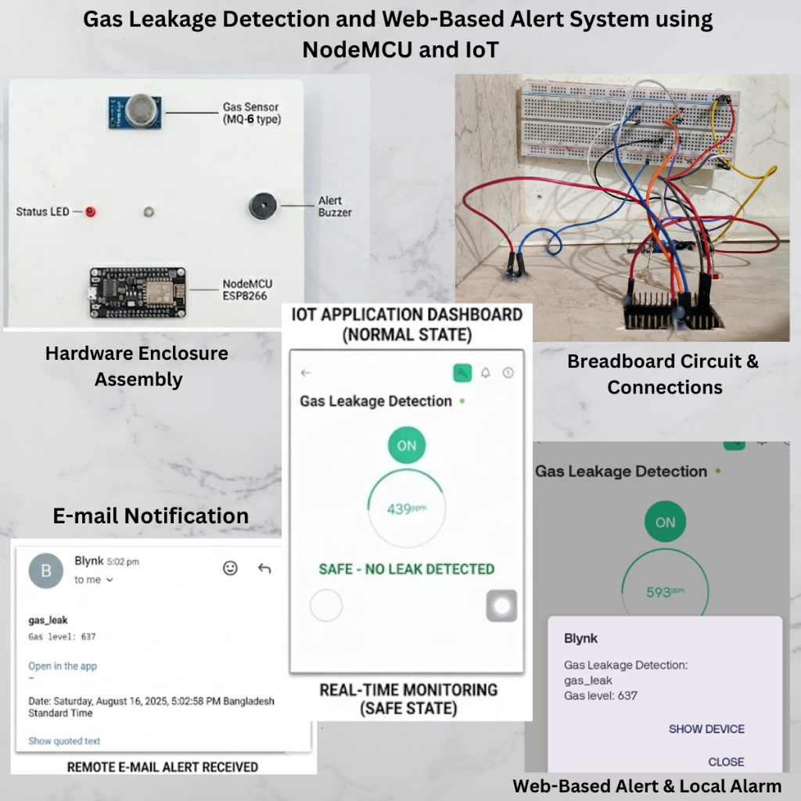
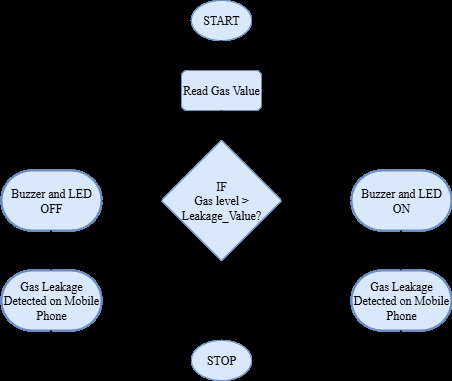
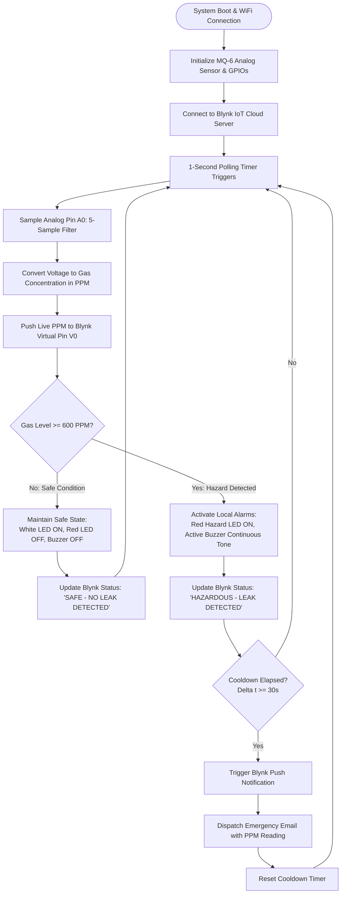
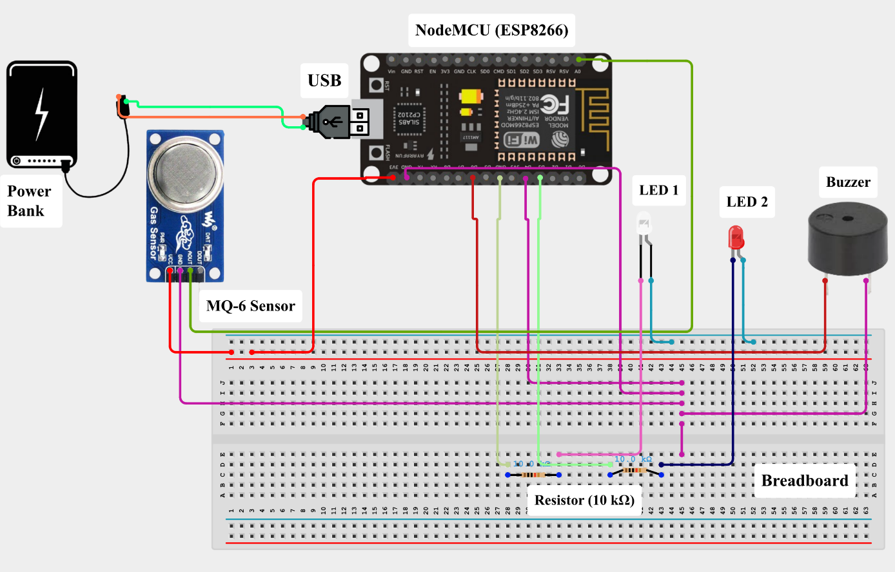

# Gas Leakage Detection and Web-Based Alert System using NodeMCU and IoT

[](https://www.espressif.com/)
[](https://isocpp.org/)
[](https://blynk.io/)
[-orange.svg)]()
[](https://ieeexplore.ieee.org/)
[](LICENSE)

An intelligent, low-cost Internet of Things (IoT) safety system engineered to detect hazardous Liquefied Petroleum Gas (LPG), Propane ($\text{C}_3\text{H}_8$), and Butane ($\text{C}_4\text{H}_{10}$) leaks in residential, commercial, and industrial settings. Powered by a **NodeMCU (ESP8266-12E)** microcontroller and an **MQ-6 semiconductor gas sensor**, the system delivers immediate dual-mode alerts: local audiovisual alarms (piezo buzzer and red status LED) and cloud-synchronized real-time monitoring via the **Blynk IoT platform**, complete with automatic push notifications and emergency email dispatch.

> **Research Citation:**  
> Presented at the *IEEE Computer Society Bangladesh Chapter (IEEE CS BDC) Summer Symposium 2025* (Paper ID: 525).

---

## 📸 Complete System Demonstration & Hardware Overview

<div align="center">
  
  <p><em>Figure 1: Complete experimental prototype overview featuring the acrylic hardware enclosure assembly, breadboard circuit wiring, Blynk IoT real-time monitoring dashboard, local alarms, and remote email alert reception.</em></p>
</div>

---

## 🌟 Key Highlights & Features

- **Continuous Real-Time Gas Sensing:** The MQ-6 tin-dioxide ($\text{SnO}_2$) semiconductor sensor interrogates ambient combustible gas concentrations across a $200 - 10,000\text{ PPM}$ dynamic range.
- **Calibrated Safety Threshold:** Governed by an empirical cutoff threshold of **$600\text{ PPM}$** ($439\text{ PPM}$ baseline in clean air vs. $637+\text{ PPM}$ during active gas leakage).
- **Dual-Mode Alert Mechanism:**
  - **Local Alarms:** Instant acoustic alert via an active piezoelectric buzzer and a high-brightness Red hazard LED.
  - **Remote Cloud Telemetry:** Live numeric gauge and status streaming to smartphone and web dashboards via Blynk IoT.
- **Automated Emergency Push & Email Dispatch:** Sends urgent push notifications and timestamped email alerts to registered users upon hazard detection.
- **Smart Notification Cooldown:** Implements a $30\text{-second}$ temporal hysteresis/cooldown timer to prevent repetitive alert flooding while maintaining critical safety awareness.
- **Remote Arm/Disarm Capability:** Users can remotely toggle system monitoring directly from the Blynk mobile interface.
- **Frugal Turnkey Construction:** Built using accessible off-the-shelf components, ensuring widespread deployability in low-resource environments.

---

## 🔄 System Architecture & Operational Workflow

<div align="center">
  
  <p><em>Figure 2: Algorithmic decision flowchart detailing sensor polling, threshold evaluation, and dual-mode alert dispatch.</em></p>
</div>



---

## 🔌 Hardware Circuit Schematic & Wiring

<div align="center">
  
  <p><em>Figure 3: Complete circuit schematic detailing pin connections between NodeMCU ESP8266, MQ-6 gas sensor, indicator LEDs, piezo buzzer, and power source.</em></p>
</div>

### Pin Connection Summary
| Component | Component Pin | NodeMCU Pin | GPIO | Description / Function |
| :--- | :--- | :--- | :--- | :--- |
| **MQ-6 Gas Sensor** | **Analog Out (A0)** | **Pin A0** | ADC0 | Analog voltage proportional to gas concentration |
| **MQ-6 Gas Sensor** | **VCC** | **Vin / 5V** | -- | $5.0\text{V}$ power for the internal $\text{SnO}_2$ heater coil |
| **MQ-6 Gas Sensor** | **GND** | **GND** | -- | Common system ground rail |
| **Active Piezo Buzzer**| **Positive (+)** | **Pin D1** | GPIO 5 | Digital Output: Continuous audible alert on leakage |
| **Red Hazard LED** | **Anode (+)** | **Pin D2** | GPIO 4 | Digital Output (via $220\,\Omega$ resistor): Leakage indicator |
| **White/Green Safe LED**| **Anode (+)** | **Pin D3** | GPIO 0 | Digital Output (via $220\,\Omega$ resistor): Normal state indicator |
| **Power Source** | **5V DC Input** | **Micro-USB** | -- | $5\text{V}$ DC from USB power bank or wall adapter |

*For complete electrical guidelines, see [hardware/circuit_schematic.md](hardware/circuit_schematic.md).*

---

## 📊 Empirical Results & Experimental Validation

The system was evaluated under controlled ambient air and active LPG exposure:

| Environmental State | Typical Gas Reading | System Status | Visual Status | Buzzer State | Cloud / Mobile Action |
| :--- | :---: | :---: | :---: | :---: | :---: |
| **Clean Air (Baseline)** | **$439\text{ PPM}$** | SAFE | White/Green LED ON | OFF (Silent) | Gauge updates live; Status: "SAFE" |
| **LPG Exposure (Leakage)**| **$637\text{ PPM}$** | HAZARDOUS | Red LED ON (Flashing) | ON (Continuous) | Push notification + Emergency Email |

- **Response Latency:** Sub-second detection at the sensor interface; local alarms triggered within $<1\text{ second}$.
- **Remote Alert Latency:** Mobile push notifications and email received within $2-4\text{ seconds}$ over standard Wi-Fi broadband.
- **False Alarm Suppression:** The 30-second hysteresis prevented notification flooding while the gas dissipated back to baseline.

---

## 🚀 Getting Started

### 1. Hardware Preparation
1. Assemble the components on a breadboard or solder onto a perfboard according to [Figure 3](docs/assets/circuit_diagram.png).
2. Connect the NodeMCU to your computer via micro-USB.

### 2. Software & Blynk Cloud Setup
1. In the [Blynk Console](https://blynk.cloud/), create a new Template with **ESP8266** hardware.
2. Configure Datastreams:
   - **V0:** Integer (0–1000) for Gas Level (PPM).
   - **V1:** String for Status Text.
   - **V2:** Integer (0 or 1) for Remote On/Off Switch.
3. Create an Event named `gas_leak` with Push Notification and Email enabled.
4. In the Arduino IDE, install:
   - **`ESP8266` Board Package** (`Tools > Board > Boards Manager`)
   - **`Blynk` Library** by Volodymyr Shymanskyy

### 3. Firmware Flashing
1. Open [`firmware/Gas_Leakage_Detection_ESP8266.ino`](firmware/Gas_Leakage_Detection_ESP8266.ino).
2. Update [`firmware/config.h`](firmware/config.h) with your `BLYNK_TEMPLATE_ID`, `BLYNK_AUTH_TOKEN`, and Wi-Fi credentials:
   ```cpp
   #define BLYNK_TEMPLATE_ID   "TMPLxxxxxx"
   #define BLYNK_AUTH_TOKEN    "Your_Auth_Token"
   #define WIFI_SSID           "Your_WiFi_Name"
   #define WIFI_PASS           "Your_WiFi_Password"
   ```
3. Select `NodeMCU 1.0 (ESP-12E Module)` and click **Upload** (`Ctrl + U`).
4. Open **Serial Monitor** at **115200 baud** to verify connection.

---

## 📂 Repository Structure

```
iot-gas-leakage-detection-nodemcu/
├── firmware/
│   ├── Gas_Leakage_Detection_ESP8266.ino   # Main embedded sketch with Blynk & timer
│   └── config.h                             # Blynk credentials, pinout, & thresholds
├── hardware/
│   └── circuit_schematic.md                 # Detailed wiring schematic & MQ-6 specs
├── docs/
│   └── assets/                              # Demonstration collage, circuit & charts
├── .gitignore                               # Clean git ignore rules
├── LICENSE                                  # MIT Open-Source License
└── README.md                                # Comprehensive project documentation
```

---

## 👨‍💻 Author & Research Citation

**Md. Al-Imran**  
*Department of Electronics and Communication Engineering*  
Hajee Mohammad Danesh Science and Technology University (HSTU), Dinajpur, Bangladesh  
- **GitHub:** [@imran7976](https://github.com/imran7976)  
- **Email:** ai.skhimran01@gmail.com  

**Publication:**  
> Md. Al-Imran, *"Gas Leakage Detection and Web-Based Alert System using NodeMCU and IoT,"* Presented at the **IEEE CS BDC Summer Symposium 2025**, Paper ID: 525.
