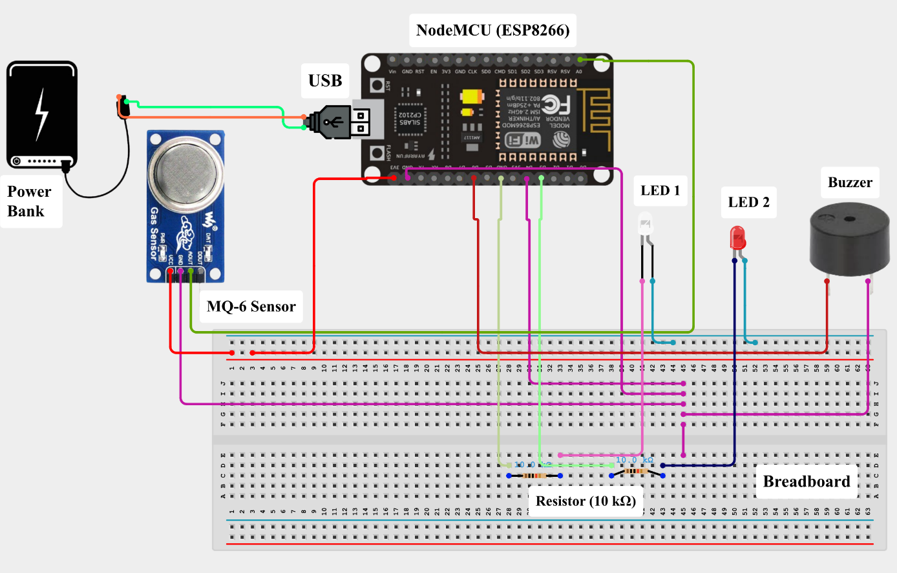

# Hardware Interconnect & Circuit Schematic

## 1. Circuit Schematic Overview

The gas detection platform interfaces an **MQ-6 semiconductor gas sensor** (analog output), dual visual status indicators (Safe vs Hazard LEDs), and an active piezoelectric buzzer with the **NodeMCU (ESP8266-12E)** microcontroller.

  
  
<em>Figure 1: Complete circuit wiring diagram between NodeMCU ESP8266, MQ-6 gas sensor, indicator LEDs, piezo buzzer, and power source.</em>

---

## 2. Pin Interconnect Mapping

| Component | Component Pin | NodeMCU Pin | GPIO Pin | Function / Logic Level |
| :--- | :--- | :--- | :--- | :--- |
| **MQ-6 Gas Sensor** | **A0 (Analog Out)** | **Pin A0** | ADC0 | Variable analog voltage proportional to LPG/Butane/Propane concentration ($0-3.3\text{V}$) |
| **MQ-6 Gas Sensor** | **VCC** | **Vin / 5V Rail** | -- | Requires regulated $5.0\text{V}$ for the internal $\text{SnO}_2$ heater element |
| **MQ-6 Gas Sensor** | **GND** | **GND** | -- | Common ground reference |
| **Piezo Buzzer** | **Positive (+)** | **Pin D1** | GPIO 5 | Digital Output: Activated when gas exceeds $600\text{ PPM}$ |
| **Piezo Buzzer** | **Negative (-)** | **GND** | -- | Common ground reference |
| **Red Hazard LED** | **Anode (+)** | **Pin D2** | GPIO 4 | Digital Output (via $220\,\Omega$ resistor): Illuminated during hazardous leakage |
| **White/Green Safe LED**| **Anode (+)** | **Pin D3** | GPIO 0 | Digital Output (via $220\,\Omega$ resistor): Illuminated during safe baseline state |
| **Power Source** | **5V USB Input** | **Micro-USB / Vin**| -- | External $5\text{V}$ DC Power Bank or regulated power adapter |

---

## 3. MQ-6 Sensor Calibration & Electrical Characteristics
- **Sensing Material:** Tin Dioxide ($\text{SnO}_2$), exhibiting low electrical conductivity in clean air and high conductivity in the presence of combustible hydrocarbon gases.
- **Target Gases:** Liquefied Petroleum Gas (LPG), Propane ($\text{C}_3\text{H}_8$), Butane ($\text{C}_4\text{H}_{10}$), and Methane.
- **Concentration Range:** $200\text{ PPM} - 10,000\text{ PPM}$.
- **Pre-Heat / Burn-in Period:** The MQ-6 internal heater coil requires approximately 24 to 48 hours of initial burn-in to stabilize the sensor resistance baseline ($R_0$).
